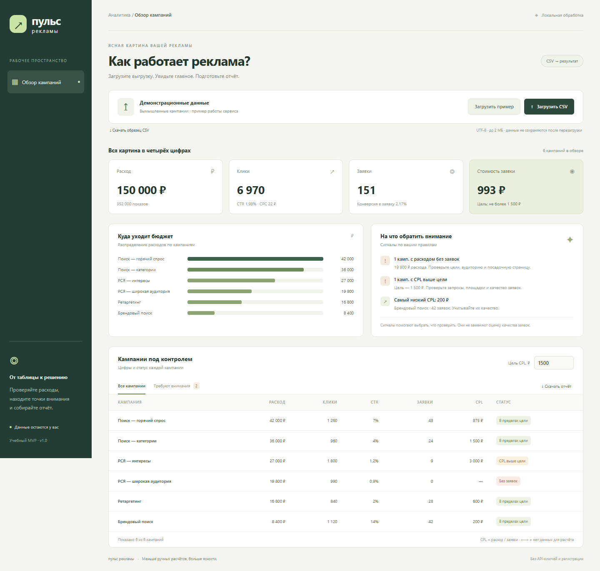
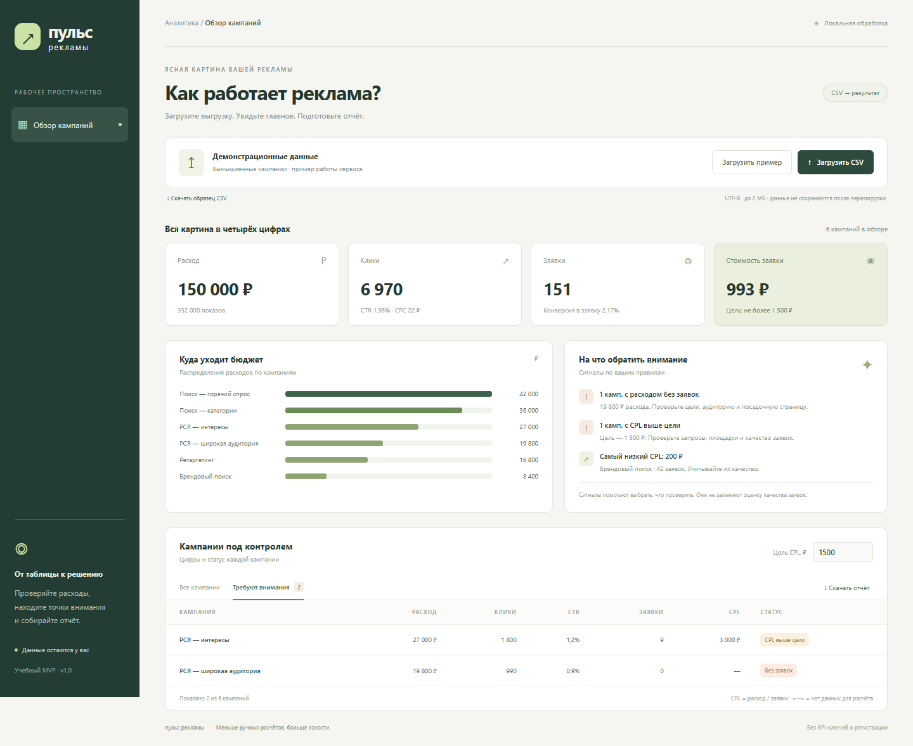
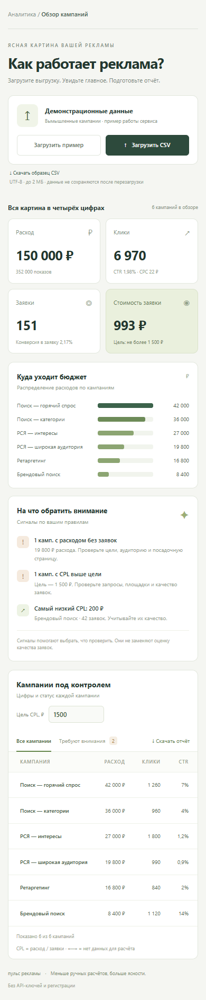

# Пульс рекламы

**CSV с рекламными кампаниями → понятная сводка, сигналы и готовый отчёт.**

Небольшой инструмент для маркетолога, который регулярно вручную считает показатели рекламных кампаний. Загрузите таблицу, задайте целевую стоимость заявки и получите обзор без ручных формул. Внешние сервисы, API-ключи и регистрация не требуются.



## Что умеет MVP

- Читает CSV в UTF-8 с английскими или русскими заголовками.
- Проверяет данные и объединяет строки одинаковых кампаний.
- Считает расход, показы, клики, заявки, CTR, CPC, CR и CPL.
- Выделяет расход без заявок и CPL выше заданной цели.
- Показывает распределение бюджета и фильтрует кампании, требующие внимания.
- Скачивает текстовый отчёт по всему загруженному файлу.
- Работает на широком экране и телефоне.

Данные обрабатываются в браузере, не отправляются на сервер и не сохраняются после перезагрузки. Встроенный пример и скриншоты содержат **вымышленные кампании**. Загрузить настоящую рабочую выгрузку можно локально; добавлять её в репозиторий не нужно.

## Запуск за минуту

Установите [Node.js](https://nodejs.org/) версии 20 или новее, скачайте этот репозиторий и откройте терминал в его папке:

```sh
npm start
```

Откройте **http://127.0.0.1:4173**. Установка пакетов не нужна. Остановка сервера: `Ctrl+C` в терминале.

1. При открытии автоматически загрузится демонстрационный пример.
2. Проверьте сводку: 150 000 ₽ расхода, 151 заявка, 6 кампаний.
3. Нажмите «Требуют внимания»: при цели CPL 1 500 ₽ увидите 2 кампании.
4. Измените цель или загрузите свой CSV.
5. Нажмите «Скачать отчёт».

Если порт занят, задайте другой перед запуском. Для PowerShell:

```powershell
$env:PORT = '4174'
npm start
```

В этом случае адрес — `http://127.0.0.1:4174`.

## Формат CSV

```csv
campaign,impressions,clicks,cost,leads
Поиск,10000,500,15000,20
Ретаргетинг,20000,300,9000,0
```

| Колонка | Русское название | Значение |
| --- | --- | --- |
| campaign | Кампания | Непустое название |
| impressions | Показы | Целое неотрицательное число |
| clicks | Клики | Целое неотрицательное число |
| cost | Расход | Неотрицательная сумма в рублях |
| leads | Заявки | Целое неотрицательное число |

Поддерживаются запятая, точка с запятой и табуляция, кавычки и BOM. Для десятичной запятой используйте разделитель `;` или заключайте поле в кавычки. Пример: `"1 000,50"`. Ограничения: 2 МБ, 10 000 строк данных, значение одного числового поля до 1 трлн. Период соответствует всей загруженной таблице: выбирайте его при исходной выгрузке.

[Скачать пример](public/demo.csv). Выгрузку из рекламного кабинета сначала приведите к указанным пяти колонкам; произвольный формат экспорта не поддерживается.

## Как считаются показатели

| Показатель | Формула |
| --- | --- |
| CTR | Клики / показы × 100% |
| CPC | Расход / клики |
| CR | Заявки / клики × 100% |
| CPL | Расход / заявки |

Повторяющиеся названия кампаний объединяются. Сводные коэффициенты считаются по общим суммам. При нулевом знаменателе показывается «—». Расход без заявок выделяется отдельно; CPL строго выше цели получает статус «CPL выше цели». Равенство цели допустимо.

Сигналы формируются по прозрачным правилам, без ИИ. Они помогают выбрать, что проверить, и не меняют настройки рекламных кампаний. Для оценки окупаемости нужны выручка, качество заявок и корректная атрибуция.

## Скриншоты

Фактические снимки локально запущенного приложения с демонстрационным CSV:



<details>
<summary>Мобильный интерфейс</summary>



</details>

## Описание, план и скилл

- [Полное описание по семи пунктам урока](PROJECT.md).
- [План разработки, составленный в Claude Code](PLAN.md).
- [Как использовался Claude Code](docs/claude-development.md).
- [Скилл проекта](.claude/skills/ad-pulse/SKILL.md).

Чтобы воспользоваться скиллом, откройте папку репозитория в Claude Code и вызовите `/ad-pulse`. Скилл объясняет запуск, проверку контрольных значений и развитие проекта, включая особенности CSV и расчётов.

## Проверки

```sh
npm test
```

Шесть автоматических тестов проверяют контрольные суммы примера, объединение кампаний, нулевые знаменатели, пороги, русские CSV и отклонение некорректных данных.

Браузерные сценарии и снимки можно повторить с установленным Playwright и Chromium либо Google Chrome. Это необязательная зависимость только для разработки:

```sh
npm install --no-save --package-lock=false playwright
node scripts/capture.cjs
```

Перед этим запустите приложение в другом терминале. Если Chromium и Chrome отсутствуют, выполните `npx playwright install chromium`. Для другого адреса задайте переменную окружения `PREVIEW_URL`. [Результат браузерной проверки](docs/browser-check.json).

## Структура

```text
public/                  Интерфейс, импорт, расчёты, отчёт и демо
server.mjs               Локальный сервер, доступ только к public/
tests/                   Автоматические проверки
images/                  Настоящие скриншоты приложения
.claude/skills/ad-pulse/  Проектный скилл для Claude Code
PROJECT.md               Описание по структуре урока
PLAN.md                  План разработки
```

## Следующая версия

Сравнение периодов, дополнительные форматы выгрузок и история отчётов. Авторизация, прямой импорт из API и автоматическое управление рекламой в текущую версию не входят.

Проект подготовлен как финальный учебный MVP курса по Claude Code.
